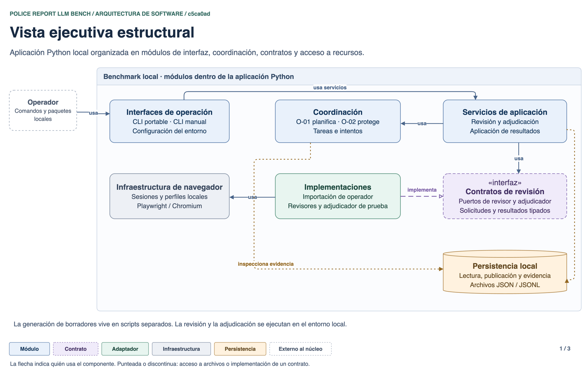

# Police Report LLM Bench

Proyecto de investigación y desarrollo en inteligencia artificial, escrito principalmente en Python, que compara y evalúa modelos de lenguaje (LLM) en la **generación de informes policiales a partir de declaraciones** y organiza la **revisión cruzada y la adjudicación** de esos informes.

El objetivo es producir datos revisados y trazables que puedan servir más adelante para especializar modelos. **El repositorio no entrena ni hace fine-tuning de modelos**: el entrenamiento queda fuera del flujo implementado.

> **Versión documentada:** rama `main`, que incluye la cadena de la fase 3 hasta F3-19 (`c5ca0ad`) y esta documentación. La fase 3 sigue `IN_PROGRESS`: las integraciones con proveedores reales no están habilitadas. Ver [Estado de publicación](#estado-de-publicación).

---

## Objetivos

- **Benchmarking de LLM:** generar borradores de informes con varios modelos abiertos (Gemma 2 2B, Mistral 7B, Llama 3.2 3B) a partir de las mismas declaraciones.
- **Comparación y evaluación:** puntuar los borradores con una rúbrica determinista (`config/rubric.yaml`) que detecta, entre otras cosas, información inventada y secciones incompletas.
- **Revisión cruzada:** tres revisores (identificados como ChatGPT, Gemini y Grok) entregan cada uno un conjunto de siete artefactos por declaración.
- **Adjudicación:** consolidar las tres revisiones en una decisión y actualizar los historiales de retroalimentación y los perfiles de cada modelo.
- **Trazabilidad:** manifiestos, hashes SHA-256, identidades de tarea e intento, y recuperación tras interrupciones.
- **Preparación de datos para un entrenamiento futuro:** conservar los casos revisados en formatos JSON/JSONL reutilizables.

## Tecnologías

| Ámbito | Tecnología | Dónde se usa |
|---|---|---|
| Lenguaje | Python 3.11 (versión exigida por la CLI portable) | Todo el proyecto |
| Generación (inferencia local) | PyTorch, Hugging Face Transformers, Accelerate, bitsandbytes | `src/model_runner.py`, `src/report_generator.py` |
| Datos | pandas, PyYAML, JSON / JSONL | `src/`, `config/`, `data/` |
| Declaradas, sin uso activo | `datasets`, `peft`, `trl`, `scikit-learn` en `requirements.txt` | Reservadas para el entrenamiento futuro; ningún módulo las ejecuta |
| Automatización de navegador | Playwright 1.60.0 y Chromium | `automation/browser/`, `automation/portable/`; sólo contra páginas `data:` y servidores fake en loopback (`127.0.0.1`/`::1`) |
| Pruebas | pytest 9.1.1, pytest-asyncio 1.4.0 | `tests/` |
| Control de versiones | Git / GitHub | — |
| Diagramas | draw.io | `docs/architecture/` |

Las dependencias están separadas: `requirements.txt` (inferencia), `requirements-automation.txt` (Playwright) y `requirements-dev.txt` (automatización + pruebas). Para revisión, adjudicación y pruebas **no hace falta** instalar `requirements.txt`.

## Arquitectura del software

Es una **aplicación Python local, modular**, con responsabilidades separadas, **puertos y adaptadores parciales** (contratos tipados que pueden implementar los revisores y adjudicadores) y **persistencia local en archivos JSON/JSONL**, sin base de datos (decisión D-012). La generación de borradores vive en scripts aparte (`src/`) y sólo comparte con la revisión el formato de los archivos: el orquestador de revisión no la invoca.



*Vista ejecutiva estructural, exportada de [`benchmark_architecture.drawio`](docs/architecture/benchmark_architecture.drawio), página 1 de 3. Corresponde a la arquitectura verificada en F3-19 (`c5ca0ad`).*

| Capa | Módulos | Responsabilidad |
|---|---|---|
| Interfaces de operación | `automation/portable/__main__.py`, `automation/review/manual_cli.py` | CLI `doctor`/`prepare` del entorno portable; CLI manual para importar revisiones y adjudicar |
| Coordinación | `automation/orchestrator.py` (O-01), `automation/workflow_coordinator.py` y `workflow_lease.py` (O-02), `state_machine.py` | O-01 planifica qué trabajo es posible; O-02 revalida el plan y toma un *lease* exclusivo; máquina de estados de tareas e intentos |
| Servicios de aplicación | `automation/review/vertical_flow.py`, `synthetic_adjudication.py`, `synthetic_application.py`, `finalization.py`, `manual_supervisor.py` | Revisión, adjudicación, aplicación a historiales/perfiles y cierre de cada declaración |
| Contratos | `automation/contracts/`, `ReviewerAdapter`, `ReviewerExecutionRequest`, `AdjudicatorAdapter`, `BundleAdjudicatorAdapter` | Datos que recibe y debe devolver cada revisor o adjudicador (`CompleteReviewResult`, `TaskResult`) |
| Adaptadores | `manual_import_adapter.py`, `fake_site_adapter.py`, `DeterministicFakeReviewerAdapter`, `DeterministicFakeAdjudicatorAdapter`, `OperatorBundleAdapter` | Traducen paquetes de operador o resultados simulados al contrato común |
| Infraestructura | `automation/browser/`, `automation/portable/` | Sesiones y perfiles privados de navegador, runtime Playwright local, configuración portable e `InputAdapter` |
| Persistencia | `review_storage.py`, `adjudication_storage.py`, `input_loader.py`, `validators.py`, `path_safety.py` | Lectura y validación de entradas, publicación atómica, manifiestos v2 y evidencia de aplicación |

Documentación detallada:

- [Resumen de arquitectura](docs/architecture/architecture_summary.md) y [análisis técnico con matriz de evidencias](docs/architecture/architecture_analysis.md).
- Diagrama editable con tres vistas: estructural, componentes y dependencias, y despliegue y persistencia: [`benchmark_architecture.drawio`](docs/architecture/benchmark_architecture.drawio).
- Contratos y decisiones: [`context/architecture.md`](context/architecture.md), [`context/decisions.md`](context/decisions.md), [`context/workflow-review-adjudication.md`](context/workflow-review-adjudication.md).

## Estado actual del desarrollo

Estados: `IMPLEMENTED_AND_TESTED`, `IMPLEMENTED_WITH_LIMITATIONS`, `PARTIALLY_IMPLEMENTED`, `NOT_IMPLEMENTED`, `BLOCKED`, `NOT_VERIFIED`. Todas las pruebas se ejecutaron en **macOS Apple Silicon con Python 3.11.17** y datos sintéticos.

### Preparación de datos

| Funcionalidad | Estado | Evidencia | Limitación |
|---|---|---|---|
| Declaraciones sintéticas (`data/statements/statements.jsonl`, 151 registros) | `IMPLEMENTED_WITH_LIMITATIONS` | Archivo versionado con metadatos | El CSV de origen (`data/raw/`) no se versiona; `src/data_loader.py` no puede regenerarlas desde un clon |
| `InputAdapter`: inspección y copia de entradas con manifiesto SHA-256 | `IMPLEMENTED_AND_TESTED` | `automation/portable/inputs.py`, `tests/test_portable_environment.py` | Exige un layout fijo y `statement_index` consecutivo desde 010 |
| Validación de JSON/JSONL (declaraciones, outputs, historiales, perfiles) | `IMPLEMENTED_AND_TESTED` | `input_loader.py`, `validators.py`, `tests/test_review_input_inspection.py` | — |

### Generación y evaluación (scripts independientes)

| Funcionalidad | Estado | Evidencia | Limitación |
|---|---|---|---|
| Generación con Gemma 2 2B, Mistral 7B y Llama 3.2 3B | `IMPLEMENTED_WITH_LIMITATIONS` | `src/report_generator.py`; dos corridas versionadas en `data/generated/runs/` (declaraciones 0–9) | Sin pruebas automatizadas; requiere GPU y acceso a modelos de Hugging Face con licencia restringida; no se ejecutó para esta documentación |
| Evaluación por rúbrica determinista | `IMPLEMENTED_WITH_LIMITATIONS` | `src/rubric_evaluator.py`, `src/run_evaluation.py` | Sin pruebas automatizadas; no se publican métricas en este README |
| Construcción de datasets train/validation/test | `PARTIALLY_IMPLEMENTED` | `src/finetuning_builder.py` | Lee `data/finetuning/approved_reports/`, que no existe; los tres JSONL versionados están vacíos |
| Entrenamiento / fine-tuning | `NOT_IMPLEMENTED` | — | Fuera del alcance actual |

### Revisión cruzada

| Funcionalidad | Estado | Evidencia | Limitación |
|---|---|---|---|
| Contratos `ReviewerAdapter`, `ReviewerExecutionRequest`, `CompleteReviewResult` (siete artefactos por revisor) | `IMPLEMENTED_AND_TESTED` | `automation/contracts/`, `vertical_flow.py`, `tests/test_review_contracts.py` | — |
| Publicación atómica del conjunto de un revisor, con manifiesto v2 y hashes | `IMPLEMENTED_AND_TESTED` | `review_storage.py`, `tests/test_review_storage.py` | La sustitución es por conjunto completo; no se mezclan intentos |
| Importación manual de paquetes del operador | `IMPLEMENTED_AND_TESTED` | `manual_import_adapter.py`, `tests/test_manual_import_adapter.py`, `tests/test_manual_supervised_flow.py` | La CLI sólo opera dentro de una raíz sintética bajo el temporal del sistema |
| Revisores fake vía Playwright y protocolo de captura verificable | `IMPLEMENTED_AND_TESTED` | `fake_site_adapter.py`, `capture_protocol.py`, `tests/test_portable_fake_reviewers.py`, `tests/test_verifiable_capture.py` | Sitios fake en loopback; no son proveedores reales |
| Reconstrucción del contexto previo a la revisión (F3-19) | `IMPLEMENTED_WITH_LIMITATIONS` | `tests/test_review_context_reproducibility.py`, [informe F3-19](docs/f3-19-review-context-reproducibility.md) | No se conserva el prompt literal ni los bytes previos del perfil; las revisiones históricas 000–009 no se pueden reconstruir |
| Adaptadores reales de ChatGPT, Gemini y Grok | `BLOCKED` | [Decisión No-Go](docs/olbm-59-provider-readiness.md) | Sin autorización de proveedores, institución ni privacidad |

### Coordinación

| Funcionalidad | Estado | Evidencia | Limitación |
|---|---|---|---|
| O-01: planificación por `statement_index` | `IMPLEMENTED_AND_TESTED` | `orchestrator.py`, `tests/test_orchestrator_planner.py` | — |
| O-02: revalidación del plan (`STALE_PLAN`) y *lease* exclusivo | `IMPLEMENTED_AND_TESTED` | `workflow_coordinator.py`, `workflow_lease.py`, sus pruebas | Una prueba de herencia del lease se omite donde no existe `os.fork` |
| Tareas, intentos y máquina de estados | `IMPLEMENTED_AND_TESTED` | `state_machine.py`, `tests/test_state_machine.py`, `tests/test_task_contracts.py` | — |
| Barrera 3/3 antes de adjudicar | `IMPLEMENTED_AND_TESTED` | `tests/test_manual_adjudication_cli.py` (bloqueo en 1/3 y 2/3) | — |
| Reanudación e idempotencia tras interrupciones | `IMPLEMENTED_AND_TESTED` | `tests/test_adjudication_process_recovery.py`, `tests/test_synthetic_range.py`, `tests/test_synthetic_executor.py` | Validado con procesos locales que se interrumpen a propósito |

### Adjudicación

| Funcionalidad | Estado | Evidencia | Limitación |
|---|---|---|---|
| Contratos y bundle de adjudicación (1 decisión, 3 historiales y 3 perfiles) | `IMPLEMENTED_AND_TESTED` | `synthetic_adjudication.py`, `tests/test_synthetic_adjudication_flow.py` | — |
| Publicación y aplicación a historiales y perfiles, con evidencia de cierre | `IMPLEMENTED_AND_TESTED` | `adjudication_storage.py`, `synthetic_application.py`, `tests/test_synthetic_application.py` | Reemplazo archivo por archivo: durante una interrupción pueden coexistir destinos aplicados y pendientes, que la recuperación completa |
| Adjudicación manual desde CLI | `IMPLEMENTED_AND_TESTED` | `manual_adjudication.py`, `manual_cli.py` | El operador aporta la decisión; la CLI no la genera |
| Adjudicador real (LLM o humano integrado) | `NOT_IMPLEMENTED` | — | Sólo existe el adjudicador fake determinista |

### Infraestructura

| Funcionalidad | Estado | Evidencia | Limitación |
|---|---|---|---|
| `BrowserManager`, `SessionManager` y perfiles privados fuera del repositorio | `IMPLEMENTED_AND_TESTED` | `automation/browser/`, `tests/test_browser_manager.py`, `tests/test_session_manager.py` | Las pruebas con Chromium real son opcionales (variables de entorno) |
| Runtime Playwright local con navegación limitada a loopback | `IMPLEMENTED_AND_TESTED` | `local_runtime.py`, `tests/test_local_browser_runtime.py` | — |
| CLI portable `doctor` / `prepare` | `IMPLEMENTED_AND_TESTED` | `automation/portable/`, `tests/test_clean_clone_reproducibility.py` | Validado en un clon aislado sólo en macOS |
| Linux, Windows y máquina remota | `NOT_VERIFIED` | — | `REMOTE_NOT_CONFIGURED` |

## Funcionalidades pendientes y limitaciones

- **Integraciones reales:** ChatGPT, Gemini y Grok están `BLOCKED_BY_PERMISSIONS`. No hay conexión con APIs ni cuentas comerciales, y la ruta automatizada no admite URLs externas.
- **Adjudicador real:** no implementado.
- **Entrenamiento / fine-tuning:** no implementado. Las dependencias `peft`/`trl` están declaradas pero nada las usa.
- **Pruebas no ejecutadas:** Linux, Windows, otro equipo, despliegue remoto, proveedores reales, QA independiente global y cobertura (`NOT_MEASURED`).
- **Portabilidad:** `doctor` exige exactamente Python 3.11 y Playwright 1.60.0.
- **Reconstrucción histórica:** las revisiones 000–009 (`data/finetuning/review_cases/`) usan un formato anterior (un archivo por revisor y uno de adjudicación) y no pueden reconstruirse con el contrato de siete artefactos.
- **Generación:** depende de un CSV no versionado y de GPU. Sin pruebas automatizadas.

## Instalación y configuración

Requisitos: Python **3.11** y Git. Para inferencia, además, GPU y acceso a los modelos de Hugging Face indicados en `config/models.yaml`.

```bash
git clone https://github.com/Allan587/police-report-llm-bench.git
cd police-report-llm-bench
```

**Entorno de revisión, adjudicación y pruebas** (sin dependencias de inferencia):

```bash
python3.11 -m venv .venv
```

```bash
.venv/bin/python -m pip install -r requirements-dev.txt
```

```bash
export PLAYWRIGHT_BROWSERS_PATH="$PWD/.playwright-browsers"
```

```bash
.venv/bin/python -m playwright install chromium
```

```bash
.venv/bin/python -m pip check
```

**Entorno de generación** (opcional, por separado):

```bash
.venv/bin/python -m pip install -r requirements.txt
```

**Configuración portable:** copia `config/portable.example.json` a `config/portable.local.json` (ignorado por Git) y ajusta las rutas. Las rutas relativas se resuelven desde el archivo de configuración. La entrada, la salida y los perfiles de navegador no pueden solaparse, y los perfiles deben quedar fuera del checkout y de carpetas sincronizadas. El layout de entrada esperado está en [docs/olbm-58-clean-clone-reproducibility.md](docs/olbm-58-clean-clone-reproducibility.md).

**Diagnóstico y preparación:**

```bash
.venv/bin/python -m automation.portable doctor --config config/portable.local.json
```

```bash
.venv/bin/python -m automation.portable prepare --config config/portable.local.json
```

`doctor` comprueba Python, Playwright, las entradas, el permiso de escritura y abre una página local en Chromium. `prepare` copia las entradas validadas a `outputs.root` y escribe `portable_manifest.json`. La fuente no se modifica.

## Ejecución local

### Revisión y adjudicación manual (datos sintéticos)

La CLI manual sólo acepta una raíz dedicada **bajo el directorio temporal del sistema**, con su `inbox`. Los paquetes de revisión y el bundle de adjudicación los aporta el operador. La CLI no genera decisiones.

```bash
ROOT="$(python3 -c 'import tempfile;print(tempfile.gettempdir())')/bench-demo"
INBOX="$ROOT/inbox"
.venv/bin/python -m automation.review.manual_cli --root "$ROOT" --inbox "$INBOX" pending
```

Subcomandos: `pending`, `prepare` (genera la plantilla del siguiente revisor), `status`, `import <paquete> --reviewer {chatgpt,gemini,grok}` y `adjudicate <bundle> --statement-index N --run-id ID`. La adjudicación se rechaza (`run_missing_reviewer`) hasta tener 3/3 revisores. El contrato completo está en [docs/olbm-54-manual-adjudication-cli.md](docs/olbm-54-manual-adjudication-cli.md).

Para una demostración reproducible que crea su propio fixture sintético y ejecuta la CLI como procesos independientes:

```bash
.venv/bin/python -m pytest -q tests/test_manual_adjudication_cli.py::test_cli_full_flow_replay_and_contradiction
```

### Revisión simulada con navegador (revisores fake)

```bash
.venv/bin/python -m pytest -q tests/test_portable_fake_reviewers.py tests/test_verifiable_capture.py
```

Levanta sitios fake en loopback, captura los siete artefactos por revisor y verifica que se rechacen las capturas parciales o inciertas.

### Generación y evaluación (scripts independientes)

Requieren el entorno de inferencia y usan los datos versionados en `data/`. Escriben nuevas corridas y resultados en `data/generated/runs/`.

```bash
.venv/bin/python src/report_generator.py --start-index 0 --end-index 4
```

```bash
.venv/bin/python src/run_evaluation.py --run-dir data/generated/runs/<run_id>
```

## Pruebas y reproducibilidad

```bash
PYTHONDONTWRITEBYTECODE=1 .venv/bin/python -m pytest -q -p no:cacheprovider
```

- Las pruebas crean sus fixtures sintéticos en directorios temporales y no tocan `data/`, `config/feedback/` ni `config/profiles/`.
- Dependen de Playwright y Chromium: `test_local_browser_runtime.py`, `test_portable_*.py`, `test_verifiable_capture.py` y `test_clean_clone_reproducibility.py`. Las pruebas de humo opcionales se activan con `RUN_BROWSER_SMOKE=1` y `RUN_BROWSER_SESSION_TESTS=1`.
- Garantías comprobadas: publicación atómica e idempotente, rechazo de resultados parciales, barrera 3/3, recuperación tras interrupciones de proceso, revalidación de planes obsoletos y cotejo de hashes.
- Evidencia registrada en [`context/advances.md`](context/advances.md): la regresión completa de F3-17 aprobó 731 pruebas y 26 subtests en macOS. Antes de publicar en `main` se ejecutó la suite completa sobre el código F3-19: **737 aprobadas, 0 fallidas, 3 omitidas** (las pruebas de humo opcionales) y 26 subtests, en macOS Apple Silicon con Python 3.11.17 y Chromium de Playwright.
- **No verificado:** Linux, Windows, máquina remota, proveedores reales y cobertura.

## Estructura del repositorio

Árbol versionado en `main` (código F3-19 más la documentación de arquitectura). Para abreviar se omiten algunos archivos individuales y los datos masivos.

```text
police-report-llm-bench/
├── automation/                 # Revisión, coordinación y adjudicación
│   ├── browser/                # Sesiones, perfiles y runtime Playwright local
│   ├── contracts/              # Contratos tipados de tareas y resultados
│   ├── portable/               # CLI doctor/prepare, configuración e InputAdapter
│   ├── review/                 # Servicios, adaptadores, almacenamiento y CLI manual
│   ├── orchestrator.py         # O-01: planificación
│   ├── workflow_coordinator.py # O-02: revalidación y coordinación
│   ├── workflow_lease.py
│   ├── state_machine.py
│   └── synthetic_executor.py
├── config/
│   ├── feedback/               # Historiales por modelo (JSONL)
│   ├── profiles/               # Perfiles acumulados por modelo (JSON)
│   ├── prompts/                # Prompts de revisión y adjudicación
│   ├── models.yaml             # Modelos de generación
│   ├── rubric.yaml             # Rúbrica de evaluación
│   ├── fields.yaml
│   ├── crime_categories_cr.yaml
│   └── portable.example.json
├── context/                    # Objetivo, arquitectura, decisiones, avances y prompts de fase
│   └── prompts/
├── data/
│   ├── statements/             # Declaraciones sintéticas (JSONL)
│   ├── processed/              # Incidentes normalizados
│   ├── generated/runs/         # Corridas de generación por modelo
│   └── finetuning/
│       ├── review_cases/       # Revisiones y adjudicaciones 000–009 (formato anterior)
│       └── checkpoints/        # Vacío (.gitkeep)
├── docs/                       # Informes por entregable (OLBM-xx, F3-19)
│   └── architecture/           # Diagrama draw.io, resumen, análisis y assets
├── src/                        # Generación, evaluación y construcción de datasets
├── tests/
│   ├── fixtures/
│   └── helpers/
├── requirements.txt            # Inferencia
├── requirements-automation.txt # Playwright
├── requirements-dev.txt        # Automatización + pytest
├── AGENTS.md
└── LICENSE
```

| Carpeta | Responsabilidad |
|---|---|
| `automation/` | Flujo de revisión cruzada y adjudicación: contratos, coordinación, servicios, adaptadores, navegador y persistencia |
| `src/` | Scripts independientes de carga de datos, generación con Transformers, evaluación por rúbrica y armado de datasets |
| `tests/` | Pruebas pytest con fixtures sintéticos y procesos auxiliares de recuperación |
| `config/` | Modelos, rúbrica, prompts, historiales y perfiles por modelo, y ejemplo de configuración portable |
| `context/` | Documentación de gobierno del proyecto: objetivo, arquitectura, decisiones, entornos, despliegue y bitácora de avances |
| `docs/` | Informes técnicos por entregable y documentación de arquitectura |
| `data/` | Declaraciones, corridas generadas y casos revisados versionados |

Las carpetas `statements/` y `reports/` no existen en la raíz: las declaraciones están en `data/statements/`, y `reports/` está ignorada por Git. Se crean en tiempo de ejecución y **no se versionan**: `config/portable.local.json`, `local-inputs/`, `local-outputs/`, `.playwright-browsers/`, `.venv*/`, `data/raw/` y los perfiles de navegador (fuera del checkout, por ejemplo `~/.police-bench/browser-profiles`).

## Alcance y uso responsable

- El entrenamiento y el fine-tuning **no están implementados**.
- Las pruebas documentadas usan **datos sintéticos**. No se versionan datos policiales reales, credenciales, cookies ni perfiles de navegador.
- Cualquier integración real con proveedores necesita autorización explícita del proveedor, de la institución y de privacidad (gate de [OLBM-59](docs/olbm-59-provider-readiness.md)).
- Los resultados de proveedores externos (incluidas las revisiones históricas 000–009) requieren verificar sus condiciones de uso y su procedencia antes de reutilizarlos.

## Estado de publicación

| Referencia | Contenido | En GitHub `main` |
|---|---|---|
| `4047600` | Fase 2: flujo sintético de revisión y adjudicación | Sí |
| `0b20bd2` … `c5ca0ad` | Cadena F3-01 → F3-19 (15 commits lineales, integrada por fast-forward) | Sí |
| Commits `docs(...)` posteriores a `c5ca0ad` | `docs/architecture/`, este README y la bitácora | Sí |

La publicación no cambia el estado de la fase 3 (`IN_PROGRESS`) ni habilita proveedores reales.

## Licencia

Apache License 2.0. Ver [LICENSE](LICENSE).
