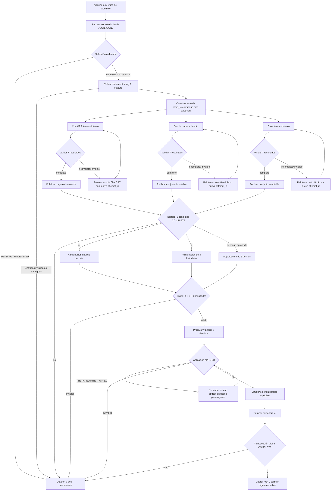

# Fase 2 — Diseño de integración del orquestador local

**Estado:** O-01 y `WorkflowLease` aprobados; coordinador O-02 remediado; existe una preparación vertical sintética de la adjudicación final de reporte sin persistencia; O-03–O-07 completos siguen pendientes.
**Fecha:** 2026-10-20.
**Alcance:** un statement por ciclo operativo, sin acceso a plataformas externas en esta entrega.

Este documento distingue explícitamente lo ya implementado de las interfaces que
deberán añadirse. No autoriza automatización web, cambios en datos reales ni cierre
de la fase 2.

## 1. Diagrama lógico

El valor de `adjudication.json.decision.status` (`approved`,
`needs_human_review` o `rejected`) no decide la rama final del diagrama. La rama
final depende de la completitud operacional: artefactos válidos, aplicación
verificada, limpieza segura y evidencia publicada.

## 2. Inventario de componentes reutilizables

### Implementado y reutilizable sin refactor previo

| Responsabilidad | Componente existente | Contrato observado |
|---|---|---|
| Descubrimiento y selección ordenada | `automation/review/statement_selector.py` y `select_statement_from_verification()` | `resume`, `advance` o `pending`; exige verificaciones de predecesores activos y bloquea huecos. |
| Carga y alineación de entradas | `inspect_review_inputs()` | Devuelve `ReviewInputValidation`; valida statement, run único o explícito y outputs Gemma/Mistral/Llama. Solo lectura. |
| Identidad de tareas e intentos | `Task`, `ExecutionAttempt`, `TaskError`, `TaskResult` | Revisión principal especializada por `statement_index`, `Reviewer` y `MAIN_REVIEW`; reintentos conservan `task_id` y cambian `attempt_id`. |
| Ciclo de vida | `automation/state_machine.py` | Transiciones explícitas; `RETRY_PENDING` es recuperable y `WAITING_REVIEW` requiere intervención. |
| Contrato de siete salidas | `CompleteReviewResult` | Una revisión principal, tres historiales y tres propuestas de perfil, todos del mismo revisor, statement e intento. |
| Inspección por revisor | `inspect_reviewer_results()` | Estados `COMPLETE`, `INCOMPLETE`, `INVALID`, `NOT_STARTED`, `UNVERIFIED`; recomienda recuperación y expone la barrera de adjudicación. |
| Publicación de revisión | `publish_complete_review()` | Publica un conjunto inmutable y confirma mediante `active.json`; idempotente y sin mezclar intentos. |
| Validadores adjudicados | `automation/review/validators.py` | Valida adjudicación final, historial, perfil y transición no regresiva de perfil. |
| Aplicación de siete destinos | `apply_adjudicated_results()` | Aplica `adjudication.json`, tres historiales y tres perfiles mediante preimágenes, material preparado y estado verificable. |
| Inspección/recuperación de aplicación | `inspect_adjudication_application()` y `resume_adjudication_application()` | Distingue `PREPARED`, `INTERRUPTED`, `APPLIED`, `INVALID`; solo recupera la misma identidad. |
| Finalización | `finalize_adjudication_application()` | Revalida identidades, limpia rutas explícitas y publica evidencia v2. |
| Completitud global | `inspect_statement_completeness()` | Separa `HISTORICAL_COMPLETE`, `COMPLETE`, `INCOMPLETE` y `UNVERIFIED`; vuelve a leer todos los destinos. |
| Sesiones aisladas | `BrowserManager` y `SessionManager` | Un contexto persistente y lock por proveedor; no navega, autentica, envía ni captura respuestas. |

### Reutilizable solo como apoyo o compatibilidad

- `src/review_data_loader.py` carga perfiles e historiales y contiene funciones de
  formato útiles, pero usa rutas globales, admite rangos y escribe archivos de
  texto. No debe convertirse en el orquestador ni saltarse
  `inspect_review_inputs()`. Sus funciones puras pueden envolverse o migrarse en
  un incremento específico con pruebas de equivalencia.
- Los nombres permanentes `<revisor>_review.json` son proyecciones de
  compatibilidad. Cuando existe `active.json`, la autoridad es el conjunto
  confirmado, su manifiesto y sus hashes.
- El lock del perfil Chromium evita que dos procesos usen el mismo perfil. No
  protege `config/feedback/`, `config/profiles/` ni el árbol de review cases.

## 3. Interfaces faltantes y contratos propuestos

Las interfaces de O-01 descritas en 3.1 y 3.2 ya existen de forma acotada en
`automation/orchestrator.py`. O-02 integra el lease con un coordinador local de
solo decisión en `automation/workflow_coordinator.py`; las interfaces de
ejecución con escritores y O-03–O-07 siguen siendo **propuestas**, no código
existente.

### 3.1 Configuración y exclusión mutua

`OrchestratorConfig`

- Entrada: rutas explícitas a statements, runs, review cases, feedback, profiles,
  prompts y raíz de perfiles de navegador; run opcional; modo headless; política
  de reintentos y límites inclusivos del rango operacional. La aplicación interna
  usa siempre `start=end=statement_actual`; notes no tiene destino.
- Salida: configuración validada, sin rutas macOS hardcodeadas y sin secretos.
- Regla: los nombres del evidence file y temporales deben declararse, no
  descubrirse por glob.

`WorkflowLease`

- Entrada: una ruta de lock local no sincronizada o una ruta operativa aprobada,
  más un identificador de ejecución sanitizado.
- Salida: lease exclusivo adquirido o error `workflow_already_running`.
- Semántica: lock de proceso mantenido desde la selección hasta la reinspección
  final. Debe usar un backend portable equivalente al ya probado para perfiles.
  No basta un archivo centinela susceptible de quedar huérfano.
- Garantía: solo el poseedor puede llamar a `publish_complete_review()`,
  `apply_adjudicated_results()`, `resume_adjudication_application()` o
  `finalize_adjudication_application()` en la ejecución integrada.

`WorkflowLease` está implementado y lo consume el coordinador local de O-02. Usa un lock
de sistema operativo no bloqueante por defecto. En POSIX el rendezvous efectivo
es el directorio padre privado y estable; el archivo contiene solo metadatos y su
existencia, eliminación o sustitución no equivale a posesión. La API comprueba la
identidad del inode mediante `validate()` y elimina copias heredadas tras `fork`.
O-01 no lo adquiere. `coordinate_workflow_cycle()` lo adquiere antes de invocar
O-01, valida el ancla antes y después de cada reconstrucción y lo libera en un
`finally`; no se conectó ningún escritor.

El modelo de confianza es cooperativo: el directorio debe pertenecer al usuario,
tener permisos `0700` o más restrictivos y no ser reemplazado mientras exista un
lease. Un proceso con permisos suficientes para renombrar o recrear ese directorio
puede invalidar el punto de encuentro; no se promete resistencia absoluta contra
ese actor. El coordinador futuro deberá revalidar el lease, el plan y las
precondiciones inmediatamente antes de cada operación persistente protegida.

`WorkflowCoordinatorConfig` exige confirmación explícita del operador sobre la
ubicación dedicada, privada, estable y no sincronizada. Además rechaza componentes
conocidos de almacenamiento sincronizado, rutas que resuelvan mediante symlink a
las raíces operacionales y ubicaciones bajo los ancestros `data` o `config`
derivados de `OrchestratorConfig`. La confirmación sigue siendo necesaria porque
ninguna heurística portable puede identificar todos los clientes de sincronización.

`CoordinationResult` usa `ACTION_REQUIRED`, `CURRENT`, `STALE_PLAN`, `CONTENDED`,
`BLOCKED` o `VALIDATION_FAILED`. Una acción operativa solo se devuelve como
`ACTION_REQUIRED` y `authorization_required=true`; esta entrega no ofrece ningún
método para ejecutarla. `CoordinationExpectation` conserva el plan anterior y la
huella de precondiciones para rechazar cambios aun cuando la acción estructural
permanezca igual.

La huella no sigue symlinks. El coordinador inspecciona de forma fail-closed los
componentes y árboles de statements, runs, review cases, feedback y perfiles
antes de dejar que O-01 lea, vuelve a verificarlos entre planificaciones y tras la
segunda. Cualquier raíz, componente intermedio, archivo o directorio simbólico
produce `VALIDATION_FAILED`, `authorization_required=false` y ningún plan
accionable, aunque el destino exista o permanezca dentro de otra ruta conocida.
La lectura ordinaria valida tipo e identidad con `lstat`/`fstat` y usa
`O_NOFOLLOW` cuando el sistema lo ofrece; la huella no incorpora inode o tiempos,
para que estados ordinarios idénticos sean deterministas.

Cada snapshot se serializa con un dominio versionado y registros binarios
inequívocos: prefijo fijo, tipo de entrada, longitud de ruta, ruta relativa,
longitud de payload y payload. Los archivos incorporan sus bytes mediante
lectura streaming; directorios, ausencias y otros tipos usan códigos separados.
El framing impide que contenido con NUL o que imite el encabezado de otra entrada
oculte adiciones, eliminaciones o cambios. Una diferencia durante la doble
revalidación produce `VALIDATION_FAILED`, `authorization_required=false` y no
expone un plan accionable.

Esto detecta sustituciones observadas durante el recorrido, pero no elimina toda
carrera posible frente a un actor hostil capaz de intercambiar y restaurar rutas
entre comprobaciones. El contrato continúa siendo cooperativo y no amplía la
garantía de `WorkflowLease`.

### 3.2 Planificación determinista

Implementado en O-01 como una capa estrictamente de solo lectura. Los contratos
inmutables `PlanningEvidence`, `PlanningBlocker`, `RecoveryPlan` y
`StatementPlan` hacen explícitos la acción, el statement, las verificaciones, la
dependencia faltante y cualquier condición que requiere intervención. Esta capa
no crea directorios, no recupera aplicaciones y no ejecuta revisores ni
adjudicadores.

`plan_next_statement(config) -> StatementPlan`

- Entrada: configuración de rutas y selección opcional de run.
- Proceso: descubrir todos los índices activos, inspeccionar cada predecesor en
  orden, inspeccionar el último y delegar la decisión al selector existente.
- Salida mínima: acción, `statement_index`, ruta, mapa de verificaciones,
  `run_id` seleccionado, dependencias faltantes y razón de bloqueo.
- No escribe, no crea el directorio del siguiente statement y no fabrica una
  declaración para un hueco.

`resume_plan(config, statement_index) -> RecoveryPlan`

- Entrada: estado reconstruido desde archivos.
- Salida: una de `RECOVER_APPLICATION`, `FINALIZE_APPLICATION`,
  `RETRY_REVIEWER`, `RUN_MISSING_REVIEWER`, `RUN_ADJUDICATIONS`, `COMPLETE`,
  `WAIT_OPERATOR`, con exactamente las identidades/rutas que la justifican.
- Prioridad: recuperar/finalizar efectos ya preparados antes de ejecutar otra
  llamada a un revisor o adjudicador.
- Guarda de identidad: una aplicación cuyo `statement_index` no coincide con el
  directorio contenedor produce `WAIT_OPERATOR` y
  `application_statement_mismatch`; nunca se recupera ni finaliza.
- Fallos de inspección: errores de acceso o de contrato producen
  `WAIT_OPERATOR` y `statement_inspection_failed`, también en la frontera inicial
  009→010; no se usa una captura indiscriminada de excepciones.
- Revisores: el mapping debe contener exactamente las tres claves `Reviewer` y
  se normaliza al orden canónico para evidencia, pendientes y reintentos.

### 3.3 Construcción de solicitudes

`AdjudicationOperation` y `AdjudicationTaskSpec`

- Problema actual: `ReviewOperation` solo representa `MAIN_REVIEW` y exige un
  `Reviewer`; los contratos genéricos pueden alojar datos de feedback o perfil,
  pero no identifican de forma tipada las tres adjudicaciones ni incorporan el
  rango de perfil en la clave lógica. Usar solo `metadata` sería insuficiente
  porque no participa en `deduplication_key`.
- Entrada: operación `FINAL_REPORT`, `HISTORY` o `PROFILE`; statement objetivo;
  proveedor ejecutor; versión/hash de prompt; y, solo para perfil, rango inclusivo
  aprobado.
- Salida: especificación inmutable capaz de crear una tarea con identidad estable,
  intentos y transiciones existentes. Reintentar conserva la identidad lógica y
  cambia el intento.
- Restricción: debe ser una extensión compatible y acotada de contratos, no una
  reinterpretación de `MAIN_REVIEW` ni un refactor de los escritores aprobados.

`ReviewerInputBuilder.build(...) -> ReviewerRequest`

- Entrada: `ReviewInputValidation` completo, perfiles actuales, historiales
  acumulados, texto/version/hash de `main_review.md`, `Task` y
  `ExecutionAttempt`.
- Salida: payload de un único statement, identidad esperada y lista exacta de
  siete artefactos.
- Debe conservar `statement_index` y `run_id`; no debe eliminar procedencia para
  facilitar el formateo.

`AdjudicationInputBuilder.build_report(...) -> AdjudicationRequest`

- Entrada: statement y outputs alineados, las tres revisiones principales
  confirmadas y `review_adjudication.md`.
- Salida esperada: exactamente un `adjudication.json` para ese statement.

`AdjudicationInputBuilder.build_histories(...) -> AdjudicationRequest`

- Entrada: nueve propuestas confirmadas (tres modelos por tres revisores) y
  `history_adjudication.md`.
- Salida persistible: tres historiales, uno por modelo. El bloque
  `ADJUDICATION_NOTES` de la respuesta cruda se valida y descarta; no tiene
  destino persistente.

`AdjudicationInputBuilder.build_profiles(...) -> AdjudicationRequest`

- Entrada: nueve propuestas confirmadas, tres perfiles acumulados,
  `start=end=statement_actual` y `profile_adjudication.md`.
- Salida esperada: tres perfiles acumulados completos. El prompt prohíbe wrappers
  y campos adicionales; no existe salida persistible de notes en este contrato.

### 3.4 Puerto de plataforma y capacidades

`ReviewerPlatformPort.execute(request, session) -> RawPlatformResponse`

- Entrada: solicitud inmutable y contexto de sesión del proveedor correcto.
- Salida: texto/respuesta cruda, fuente, timestamps y metadatos visibles; nunca
  debe afirmar una versión de modelo que la UI no revele.
- Errores: tipados como reintentables, no reintentables o intervención humana.
- La implementación concreta pertenece a una entrega posterior y debe respetar
  una matriz de capacidades por plataforma. Si envío o captura no están
  autorizados, el mismo puerto debe admitir importación manual asistida.

`AdjudicationPlatformPort` usa una conversación ChatGPT separada por tipo de
adjudicación. La revisión ChatGPT y las tres adjudicaciones no deben compartir
conversación, aunque puedan compartir el perfil persistente autorizado.

### 3.5 Parseo y validación

`ReviewerResponseParser.parse(raw, expected) -> CompleteReviewResult`

- Acepta solo una revisión principal, tres historiales y tres propuestas de
  perfil.
- Inyecta o asocia procedencia únicamente desde el envelope confiable de la
  ejecución; si el contenido incluye identidad contradictoria, falla.
- No publica resultados parciales. Todo error devuelve diagnóstico y conserva la
  respuesta cruda fuera de destinos acumulativos según la política de datos.

`AdjudicationResponseParser.parse_report(...) -> Mapping`

`AdjudicationResponseParser.parse_histories(...) -> 3 histories`

`AdjudicationResponseParser.parse_profiles(...) -> 3 profiles`

- Cada parser aplica los validadores compartidos antes de que el resultado pueda
  llegar al escritor.
- El bundle de aplicación contiene exactamente siete efectos persistentes: una
  adjudicación, tres registros de historial y tres perfiles completos.
- Las notes no forman parte de esos siete efectos: el parser las valida como
  bloque no aplicable y las descarta sin persistirlas.

### 3.6 Coordinador

`run_statement(config, ports) -> RunOutcome`

- Orquesta componentes; no replica sus validaciones ni escribe JSON directamente.
- Devuelve índice, acción final, tareas/intentos, conjuntos activos, aplicación,
  evidencia, estado de completitud y bloqueo sanitizado.
- Solo devuelve `ADVANCE_ALLOWED` tras una reinspección global `COMPLETE`.
- Conserva por separado `adjudication_decision_status` y
  `operational_completion_status`.

## 4. Secuencia operacional propuesta

1. Adquirir `WorkflowLease` antes de leer el estado que determina la selección.
2. Reconstruir las verificaciones activas en orden ascendente y seleccionar con
   los componentes existentes.
3. Si hay una aplicación preparada/interrumpida, recuperarla y finalizarla antes
   de cualquier interacción externa.
4. Validar entradas y fijar un `run_id`; ante ambigüedad, detenerse hasta que el
   operador elija el run.
5. Construir una entrada individual con declaración, tres outputs, perfiles e
   historiales acumulados.
6. Inspeccionar los tres revisores. Conservar cada conjunto `COMPLETE`; ejecutar
   solo `NOT_STARTED`; repetir como unidad completa solo `INCOMPLETE` o `INVALID`.
   `UNVERIFIED` requiere intervención, no repetición automática.
7. Para cada ejecución crear una tarea lógica y un intento. Un reintento conserva
   `task_id`, incrementa `attempt_number` y cambia `attempt_id`.
8. Parsear las siete salidas en memoria y construir `CompleteReviewResult`.
   Publicar únicamente después de validar las siete.
9. Reinspeccionar. No iniciar adjudicación hasta que los tres revisores estén
   `COMPLETE` desde sus referencias activas.
10. Ejecutar tres adjudicaciones independientes: reporte, historiales y perfiles.
    Las de reporte e historial son por statement. La de perfil usa solo el rango
    aprobado por el operador.
11. Validar el bundle `1 + 3 + 3`, y llamar una sola vez al escritor de
    adjudicación con las identidades derivadas de los tres conjuntos activos.
12. Si la aplicación se interrumpe, reanudar el mismo `application_id`; no volver
    a adjudicar y no crear un bundle competidor.
13. Finalizar con temporales explícitos, publicar evidencia v2 y reinspeccionar el
    statement desde archivos.
14. Solo ante `COMPLETE` liberar el índice para avance. Liberar el lease en todos
    los caminos de salida.

## 5. Reintentos y recuperación

### Revisión principal

- `COMPLETE`: conservar; nunca repetir por conveniencia.
- `NOT_STARTED`: crear primera tarea/intento.
- `INCOMPLETE` o `INVALID`: transición a `RETRY_PENDING`; ejecutar de nuevo las
  siete salidas del revisor afectado. No reutilizar fragmentos previos.
- `UNVERIFIED`: `WAITING_REVIEW`; un operador debe resolver procedencia o aprobar
  una acción. No se inventa identidad.
- La publicación de un nuevo intento cambia solo el `active.json` del revisor;
  los otros dos conjuntos quedan intactos.

### Adjudicación y aplicación

- Respuesta de adjudicación inválida: repetir solo esa adjudicación antes de
  preparar efectos; conservar las otras respuestas válidas como candidatos
  temporales identificados, sin aplicarlas parcialmente.
- `PREPARED` o `INTERRUPTED`: usar `resume_adjudication_application()` con el
  mismo manifiesto y preimágenes. No volver a ejecutar modelos.
- `APPLIED` sin evidencia: ejecutar finalización idempotente.
- `INVALID`, hash tercero, identidades activas cambiadas o perfil/historial
  posterior: bloquear en `WAITING_REVIEW`; nunca restaurar una preimagen vieja.
- Evidencia existente distinta: bloquear antes de limpiar.

### Continuidad del statement pendiente

Cada arranque comienza por inspección, no por un contador en memoria. El
statement incompleto anterior prevalece sobre cualquier directorio posterior.
Una verificación ausente o `UNVERIFIED` bloquea; una verificación `INCOMPLETE`
reanuda; solo todos los predecesores `COMPLETE` permiten avanzar.

## 6. Único escritor activo

La implementación debe añadir una exclusión mutua de workflow, separada de los
locks Chromium. La opción recomendada es un lock de sistema operativo, portable
y no bloqueante, mantenido por un único proceso coordinador durante todo el ciclo.
El lock debe cubrir como mínimo cualquier operación que pueda publicar conjuntos,
aplicar historiales/perfiles o finalizar evidencia; mantenerlo desde selección
evita que dos procesos planifiquen el mismo statement sobre la misma preimagen.

Los hashes y preimágenes existentes continúan siendo la segunda barrera frente a
cambios externos. El lease no sustituye validaciones, y las validaciones no
sustituyen el lease. Procesos heredados que escriban fuera del orquestador siguen
siendo un riesgo operativo que debe documentarse y deshabilitarse durante una
ejecución integrada.

## 7. Riesgos y decisiones pendientes

### Decisiones consolidadas y aprobaciones aún externas

1. **Persistencia de `ADJUDICATION_NOTES`.** D-034 resuelve que no se persiste ni
   participa en completitud o evidencia. El parser conserva únicamente los tres
   historiales adjudicados.
2. **Rango de adjudicación de perfiles.** D-034 fija
   `start=end=statement_actual`, como actualización incremental sobre el acumulado
   previo; los escritores mono-statement no cambian.
3. **Run ambiguo.** Cuando más de un run contiene el índice, el operador debe
   indicar `run_id`; nunca elegir por fecha o nombre.
4. **Capacidades por plataforma.** Aprobar por separado navegación, envío,
   captura e importación manual para ChatGPT, Gemini y Grok.
5. **Ubicación del workflow lock y material crudo.** Deben quedar fuera de rutas
   sincronizadas si contienen estado sensible; confirmar retención y permisos.
6. **Política de reintentos.** Definir máximo, backoff y qué errores de plataforma
   requieren intervención inmediata. La validación determinista nunca se omite al
   agotar reintentos.

### Riesgos técnicos conocidos

- TOCTOU de rutas entre comprobación y syscall; ya documentado y no resuelto por
  este diseño.
- Un actor con capacidad de reescritura coordinada puede reconstruir hashes; se
  garantiza integridad operativa, no autenticidad criptográfica.
- Cierre inesperado o expiración de una sesión autenticada puede requerir acción
  manual aun cuando el perfil Chromium sea recuperable.
- Respuestas UI con Markdown, texto adicional o truncamiento requieren parsers
  estrictos y nunca deben transformarse silenciosamente en resultados válidos.
- Una ejecución heredada fuera del lease puede competir por destinos acumulativos.
- Evidencia v1 antigua no prueba perfiles históricos que ya avanzaron; no debe
  migrarse ni fabricarse retroactivamente.

## 8. Plan incremental y pruebas de aceptación

### Incremento O-01 — Planificador de solo lectura

**Implementación propuesta:** `OrchestratorConfig`, `StatementPlan`,
`RecoveryPlan` y funciones de planificación que compongan selectores e inspectores
existentes. Sin navegador ni escrituras.

**Aceptación:**

- 009 histórico + 010 incompleto selecciona 010.
- 010 y 011 completos seleccionan `ADVANCE 012`.
- Predecesor ausente o `UNVERIFIED` bloquea.
- Run ambiguo produce `WAIT_OPERATOR`.
- Aplicación `PREPARED`, `INTERRUPTED` o `APPLIED` sin evidencia se prioriza sobre
  nuevas revisiones.
- Aplicación con identidad de otro statement bloquea explícitamente.
- Inspección inicial sin permisos devuelve un plan trazable en vez de propagar
  `PermissionError` cuando el sistema operativo aplica la denegación.
- Mappings equivalentes de revisores producen planes estructuralmente iguales;
  claves faltantes, adicionales o de tipo inválido bloquean.
- Snapshot de archivos antes/después idéntico; suite QA3-01 sin regresiones.

### Incremento O-02 — Lease de escritor único

**Implementación actual:** el lock portable está integrado con un coordinador
local de solo decisión y con una prueba de ejecución sintética confinada. El
coordinador público adquiere, reconstruye y revalida O-01, compara la huella y
libera sin efectos. La API interna reutilizable deja el lease adquirido para que
`synthetic_executor.py` repita plan, huella, ancla, identidad y preimagen justo
antes de crear exclusivamente un archivo temporal nuevo. No se cambiaron O-01 ni
los escritores aprobados y ninguna acción operacional está conectada.

**Aceptación:**

- Dos procesos: solo uno adquiere el lease.
- Liberación normal y tras excepción permite una nueva ejecución.
- Un lock de proceso terminado no deja bloqueo lógico permanente.
- Tres locks de navegador siguen siendo independientes del lock del workflow.
- Ninguna prueba toca perfiles, historiales o datos reales.
- Un plan previo o una huella de almacenamiento obsoletos se rechazan.
- Cambios de aplicación o referencia activa durante la revalidación bloquean el
  resultado aunque la acción aparente sea idéntica.
- Cualquier symlink en una dependencia observada, incluso roto, circular,
  intermedio o hacia fuera de la raíz, falla cerrado antes de autorizar una acción.
- Una sustitución controlada por symlink después de la segunda planificación se
  detecta; dos estados ordinarios idénticos conservan la misma huella.
- Dos árboles distintos no pueden compartir la representación por concatenación:
  rutas y payloads tienen longitudes explícitas, incluso con contenido NUL o que
  imite encabezados de otros registros.
- Dos coordinadores reales no entran simultáneamente en el ciclo protegido.
- El efecto sintético se observa con el mismo lease todavía adquirido y un
  segundo proceso devuelve `CONTENDED` sin crear su destino.
- Plan obsoleto, mutación de revisión/aplicación, cambio de identidad o preimagen,
  pérdida del ancla y rutas externas o simbólicas impiden el efecto.
- La evidencia sintética registra únicamente hashes y metadatos del archivo
  temporal; un error no reintenta ni autoriza escritores operacionales.

### Incremento O-03 — Builders y parsers puros

**Implementación propuesta:** identidad tipada de las tres adjudicaciones,
requests de un statement y parsers de las siete salidas y de las tres
adjudicaciones. Sin Playwright.

**Aceptación:**

- El input contiene statement, tres outputs alineados, tres perfiles, tres
  historiales, `statement_index`, `run_id` y hash/version de prompt.
- Cada revisor válido produce exactamente un `CompleteReviewResult`.
- Faltante, duplicado, modelo incorrecto, índice incorrecto o identidad
  contradictoria rechaza el conjunto completo.
- Parsers adjudicados producen exactamente `1 + 3 + 3`; notes se validan como
  salida no aplicable y no se persisten.
- Reporte, historial y perfil tienen claves lógicas diferentes; el rango de
  perfil participa en la identidad y no queda escondido en `metadata`.
- Fixtures de texto truncado/Markdown no modifican destinos.

### Incremento O-04 — Coordinador de revisores con puerto simulado

**Implementación propuesta:** tareas/intentos, política de reintento y publicación
de conjuntos usando un adaptador falso determinista.

**Aceptación:**

- Tres revisores completos se publican y habilitan la barrera.
- Fallo de Gemini repite sus siete salidas con mismo `task_id` y nuevo
  `attempt_id`; ChatGPT y Grok no cambian.
- Interrupción antes/después de `active.json` conserva un conjunto íntegro.
- Una proyección anterior a `active.json` solo permite reintento si coincide con
  un set inmutable completo y verificable; no se confirma ni se elimina.
- `UNVERIFIED` entra en espera y no llama al puerto.
- Reinicio reconstruye el plan desde archivos, no desde memoria.
- Reinicio de un huérfano v2 conserva `task_id`, incrementa `attempt_number` y
  valida `run_id` más `task_deduplication_key`; evidencia heredada o ambigua
  bloquea sin inventar identidad.

### Incremento O-05 — Coordinador de adjudicaciones con puerto simulado

**Precondición:** contrato D-034 de rango mono-statement y descarte de notes.

El incremento vertical de 2026-10-29 no satisface ni sustituye O-05: prepara en
memoria solo la adjudicación final de reporte, reutiliza el validador existente y
se detiene antes de historiales, perfiles, descarte de `ADJUDICATION_NOTES`, aplicación,
finalización y evidencia persistente. Por no ejecutar esos efectos, no necesita
implementar esas salidas y efectos.

**Implementación propuesta:** tres requests independientes, validación del bundle,
aplicación, recuperación, finalización y reinspección.

**Aceptación:**

- Sin tres revisores `COMPLETE`, cero adjudicaciones.
- Las tres conversaciones lógicas son independientes.
- Un adjudicador inválido se repite sin aplicar los otros resultados.
- Interrupciones en cada destino recuperan la misma aplicación sin duplicados.
- Los tres valores de `decision.status` alcanzan completitud operacional cuando
  todos los efectos y la evidencia son válidos.
- `INVALID` o cambio de preimagen bloquea sin sobrescribir.

### Incremento O-06 — E2E local sintético, sin plataformas

**Implementación propuesta:** ensamblar O-01 a O-05 con puertos falsos, datos bajo
`tmp_path` y cierre limpio del lease.

**Aceptación:**

- Escenario 009 → 010 → 011 → `ADVANCE 012` mediante la API del orquestador.
- Corte y reinicio durante revisión, aplicación y limpieza.
- Historiales sin duplicados, perfiles no regresivos, evidencia v2 verificable y
  protección 000–009.
- Suite completa local y regresiones QA-01 a QA3-01 aprobadas.
- Plataformas externas y remoto siguen `NOT_RUN` / `REMOTE_NOT_CONFIGURED`.

### Incremento O-07 — Adaptadores Playwright autorizados

**Precondición:** autorización explícita y matriz de capacidades aprobada.

**Implementación propuesta posterior:** integrar los puertos con
`SessionManager`, una plataforma por adaptador, manteniendo importación manual
asistida donde la automatización no esté autorizada.

**Aceptación mínima:** pruebas en páginas sintéticas, aislamiento de conversaciones
y sesiones, cancelación segura, sanitización de errores y cero secretos en logs.
Las pruebas reales por plataforma se registran por separado y no se infieren de
los mocks.

## 9. Primer incremento implementable

El primer incremento implementable es **O-01 — Planificador de solo lectura**.
Tiene el menor riesgo, cierra la interfaz principal que hoy falta, reutiliza los
componentes que superaron QA3-01 y puede validarse por completo con fixtures sin
navegador ni efectos persistentes. Requiere autorización explícita antes de
escribir código.
